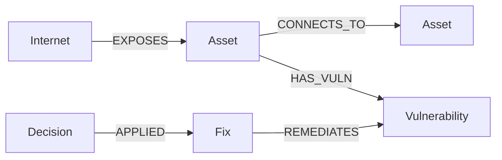

# Stratum: a graph-powered security triage agent

Track: Agents That Act on Connected Data (Graph Hacks: Context for AI Agents)

Live demo: graph-agent.streamlit.app
Demo video: VIDEOLINK

## What it does
Stratum finds every route an attacker could use to reach a company's most important system, picks the single fix that closes the most routes, applies it, and proves the result by searching again. FalkorDB holds the network as a graph and answers every question about it. NVIDIA Nemotron ULTRA 3 decides which tool to use next and writes the report. The demo network is simulated.

## Why a graph
Attack routes are multi-hop paths through connected computers, accounts and weaknesses. A graph query follows those connections directly, and the agent can explain every decision with the exact route behind it.

## Graph model overview

| Node | Properties | Meaning |
|---|---|---|
| Internet | name | The outside world, the start of every attack route |
| Asset | name | A computer, account or system |
| Vulnerability | id, severity, fixed | A weakness on an asset |
| Fix | action | An action that removes one or more weaknesses |
| Decision | reason, time | A record of a fix the agent applied, and why |

Relationships: EXPOSES (reachable from the Internet), CONNECTS_TO (one asset can reach another), HAS_VULN (an asset has a weakness), REMEDIATES (a fix removes a weakness), APPLIED (a decision records an applied fix).

How the graph is used: a variable-length path query finds every route from the Internet to the systems being protected, up to 6 hops. A route is open only if every computer on it has an unfixed weakness. The agent compares every fix, applies the one that closes the most routes, recounts and repeats. Each applied fix is saved as a Decision node linked to the fix, so every action can be traced in the graph. Each visitor session gets its own private, temporary graph, so uploads never collide.

## How the agent works
1. investigate: finds every open attack route to the systems you want to protect, counts how many routes pass through each computer (the chokepoints) and compares every available fix in memory, from one set of graph queries.
2. remediate: builds a fix plan with a greedy algorithm (apply the fix that closes the most routes, recount, repeat until no route is left, optionally fixing every weakness) and writes each applied fix and its reason into the graph as a Decision node.
3. Nemotron writes the report. NVIDIA Nemotron chooses which tool to call through function calling and explains the result. The graph supplies every fact, so the model cannot invent routes or fixes.
Each visitor gets a private temporary graph, so uploads never collide.

## Key graph queries
Routes from the Internet to a target:

    MATCH p = (:Internet)-[:EXPOSES|CONNECTS_TO*1..6]->(t:Asset {name:$target})
    RETURN [n IN nodes(p) | n.name] AS route

A route is open only if every computer on the way (not the Internet, not the target) has an unfixed vulnerability. That filter runs on the results of the query above plus this one:

    MATCH (a:Asset)-[:HAS_VULN]->(v:Vulnerability)
    WHERE v.fixed IS NULL OR v.fixed = false
    RETURN a.name, v.id

Applying a fix and recording the decision:

    MATCH (f:Fix {action:$a})-[:REMEDIATES]->(v:Vulnerability)
    SET v.fixed = true
    CREATE (d:Decision {reason:$r, time:$t})-[:APPLIED]->(f)

algorithms.py also provides PageRank through FalkorDB (CALL algo.pageRank) to rank the most important targets.

## Files
build_graph.py (creates the simulated network for local use), tools.py (route queries), analysis.py (in-memory route and fix-plan analysis), actions.py (apply fix, reset), algorithms.py (PageRank, route chokepoints), agent.py (Nemotron tool-calling loop), loader.py (builds a graph from the demo or an uploaded CSV), app.py (Streamlit page with two tabs), db.py (database connection), samples/ (example networks), mcp_server.py and mcp_agent.py (the analysis tools as an MCP server, and an agent that discovers them through MCP).

## Run it yourself
    git clone https://github.com/jayanthh1524/attackpath
    cd attackpath
    python3 -m venv venv
    source venv/bin/activate
    pip install -r requirements.txt

Create a file named .env with these settings (never commit it):

    NVIDIA_API_KEY=your_key
    FALKORDB_HOST=localhost
    FALKORDB_PORT=6379

For a local database run FalkorDB in Docker (docker run -p 6379:6379 falkordb/falkordb:latest) or use a FalkorDB Cloud instance and add FALKORDB_USERNAME, FALKORDB_PASSWORD and FALKORDB_SSL. Then:

    python3 build_graph.py
    streamlit run app.py

## Try it on your own network
Open the Analyze your own network tab, download the CSV template or a sample (samples/startup.csv, samples/office.csv), edit it, upload it, choose the valuable systems to protect (for example customer data, not the entry points), run the agent and download the report. Columns: kind,name,target,id,severity,fix, where kind is exposed, connection or weakness. Limits: 25 computers, 60 connections, routes searched up to 6 hops, 6 agent runs per session and 40 per hour for everyone. Uploaded data is analyzed in a private temporary graph. Do not upload sensitive data to the public demo.

## Tool selection through MCP
The same analysis is also published as an MCP server (mcp_server.py) with three tools: list_sample_networks, investigate_network and remediate_network. mcp_agent.py is an agent that connects to that server, discovers the tools through the MCP protocol, lets NVIDIA Nemotron choose which ones to call, and writes the report. Run it locally with:

    pip install "mcp<2"
    python3 mcp_agent.py

The web app calls the same analysis code directly. The MCP server works on temporary graphs that it deletes after each call.

## Notes
- The network in the demo is simulated. The agent recommends and simulates fixes; it never changes real systems.
- Do not upload sensitive company data to the public demo.
- AI tools (including an AI assistant) helped write parts of the code. The idea, the design decisions, the testing and the deployment are mine, and I can explain every file.

## Roadmap
Weighing fixes by effort and downtime, using PageRank in the fix ranking, and scanning your own machine's inventory.
